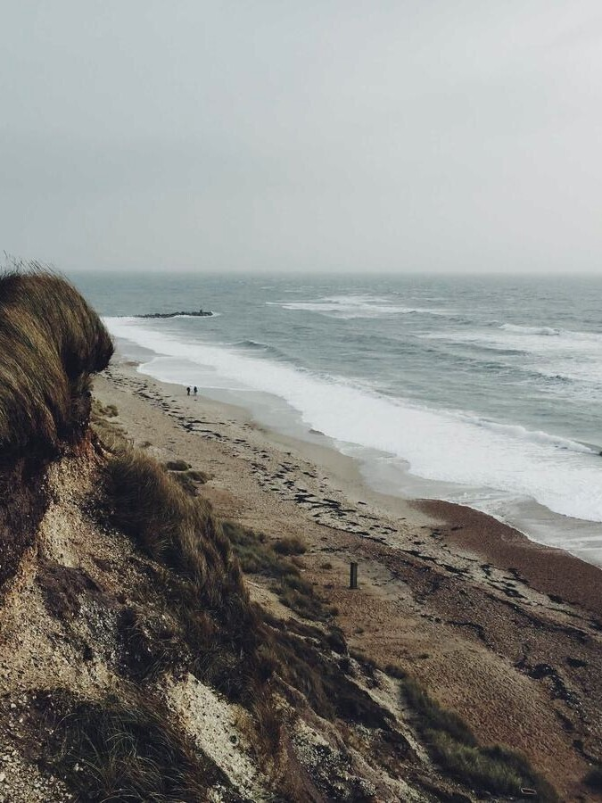
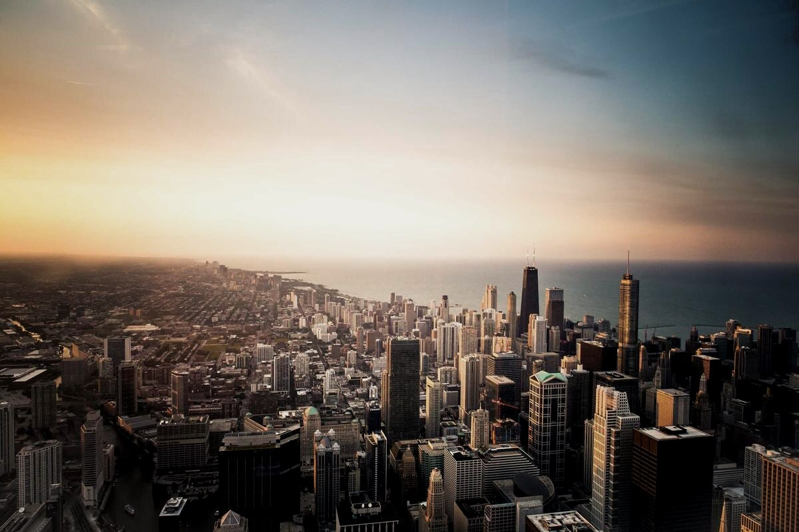

# Overview

> This page is an ordinary Markdown note: no extra syntax, no hand-written pixel sizes.
> Column widths, row heights, crops and captions are all computed by the plugin from content and aspect ratios.

Three photos with different aspect ratios written in the same paragraph; the plugin works back from the row height to each cell's column width, aligning top and bottom edges:

As the body text continues, a single image narrows automatically according to its ratio; the one whose width stays under the float threshold lets text wrap alongside it. Below is a continuous passage from the same note, with the image floating on the right:

The point of the layout is not to make images bigger, but to spare the reader from jumping back and forth between "looking at pictures" and "reading text". How much width an image takes, which side it sits on, and when the wrap ends are all decided by ratio and structure; the rhythm of the text always leads, and the image follows. When a passage needs to run on, the float ends automatically at the next heading, code block, table or blockquote, and the following text fills the full column again.

## Crops and captions

The same photo can be used for just one part of itself: a square framing emphasises detail, a wide framing establishes the setting. After cropping, the width is recalculated from the new frame ratio — a square image grows narrower by itself instead of filling the column.

Captions always follow the image unit, not the paragraph: centred per cell when side by side, hugging the image edge when floating.

## The rhythm of a note

In a long document, image groups don't all have to sit on one row. Two portrait images side by side can set up a comparison, and the three landscape images right after them are well suited to opening up a scene:

Everything above comes from a single set of settings: Gallery max per row 5, Gallery min height 100, Gallery max height 600, float threshold 60%. Change any one of them and this page reflows immediately — no Markdown rewrite, no manual adjustment of any image.

> Image layout should work like text layout: readers see only the result, never the operations.

Go back to [[README|Contents]] to read in order, or jump straight to [[01-quick-start]].
