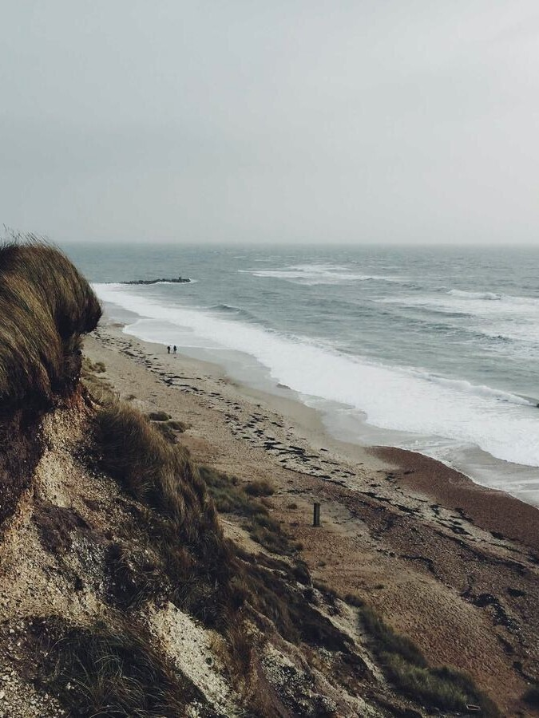
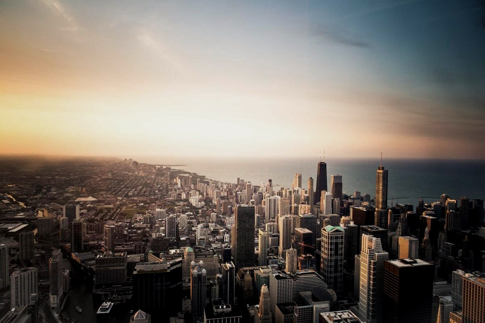

# 效果总览

> 这一页是一篇普通的 Markdown 笔记：没有额外语法，没有手写像素尺寸。
> 图片的栏宽、行高、裁剪与图注全部由插件按内容与比例计算。

三张比例不同的照片写在同一段里，插件按行高反推每一格的列宽，顶边与底边对齐：

正文继续往下写时，单图会按比例自动收窄；宽度不超过浮动阈值的那一张，会让文字绕到它旁边。下面是同一篇笔记里的一段连续文字，图片浮动在右侧：

排版的目的不是把图片放大，而是让读者在阅读时不必在「看图」和「读字」之间反复跳转。图片占多少宽度、落在哪一侧、什么时候结束绕排，都由比例与结构决定；正文的节奏始终是主导，图片只是配合。当一段文字需要连续说明时，浮动会在下一个标题、代码块、表格或引用处自动终止，后续正文重新占满整栏。

## 裁剪与图注

同一张照片可以只取其中一块：方形取景用于强调细节，宽幅取景用于交代环境。裁剪之后，宽度会按新的画幅比例重新计算 —— 方图自动变窄，不再占满整栏。

图注始终跟随图片单元，而不是段落：并排时逐格居中，浮动时贴着图片边缘。

## 一篇笔记的节奏

长文里，图片组不必都排成一行。两张竖图并排可以交代一组对比，紧接着的三张横图则适合铺开一个场景：

以上所有效果都来自同一份设置：最大并列 5 张、最小行高 100、行高上限 600、浮动阈值 60%。改动其中任何一项，这一页会立刻重排 —— 不需要重写 Markdown，也不需要手动调整任何一张图。

> 图片排版应该像文字排版一样：读者只看到结果，看不到操作。

回到 [[README|目录]] 按顺序阅读，或直接看 [[01-五分钟上手]]。
