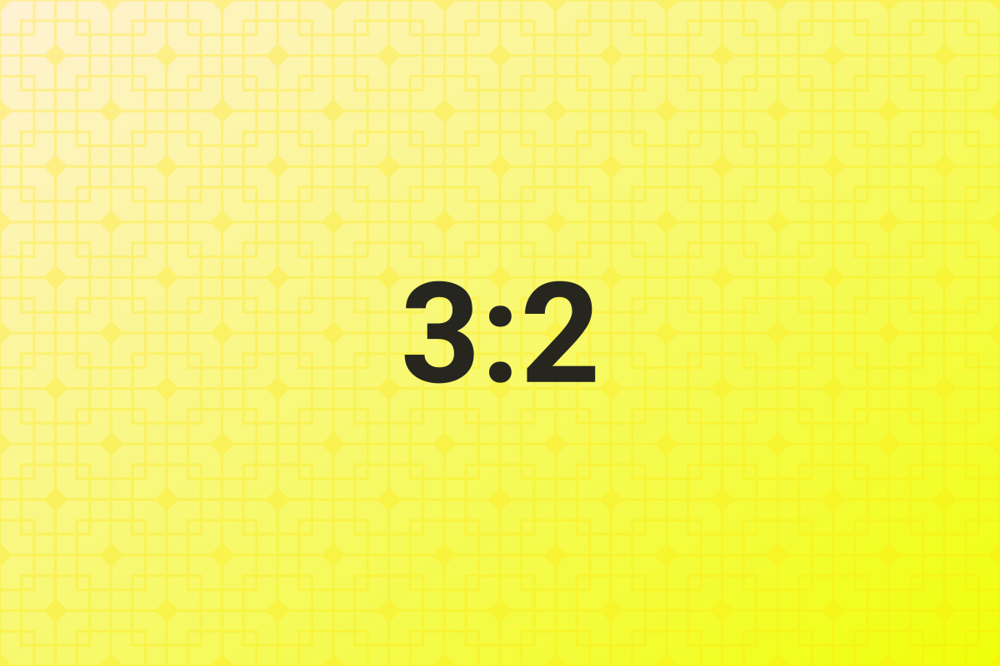

# Grouping rules

> Images may be separated by at most two blank lines; the third blank line, any line of body text or any heading ends the current gallery.

## Zero blank lines

Three lines written back to back become one row of three cells.

## One blank line

Reading view discards blank lines, so no gap is visible on screen; the plugin reads the **source text** and still treats them as one group.

## Two blank lines

Still one group — two blank lines is the limit.

## Three blank lines

The third blank line ends the group, so this becomes two groups: J on a row of its own, K and L side by side.

## Broken by body text

This line of body text separates the image above from the image below.

As soon as one non-empty line of text is inserted in between, the gallery ends, regardless of how many blank lines there are.

## Broken by a heading

### Subheading

A heading is a structural boundary too: it takes no part in image grouping and is not pulled into the row above.

## Related

- Row splitting and mixed ratios: [[04-row-splitting]]
- The difference between `ag:isolate` and `ag:exclude`: [[10-parameter-reference]]

---

Previous · [[02-core-concepts]] ｜ [[README|Contents]] ｜ Next · [[04-row-splitting]]
