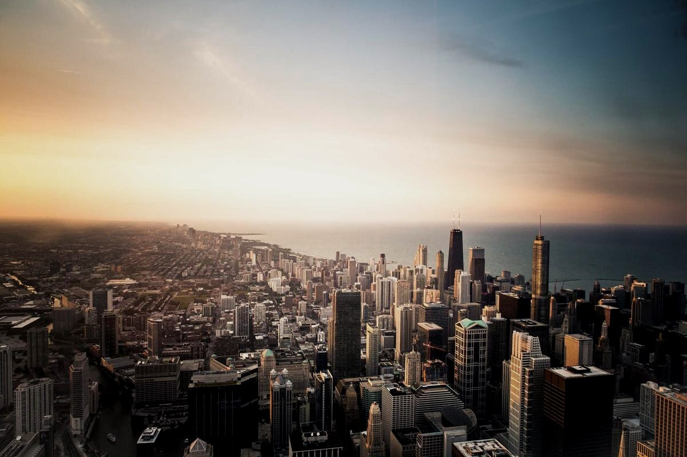
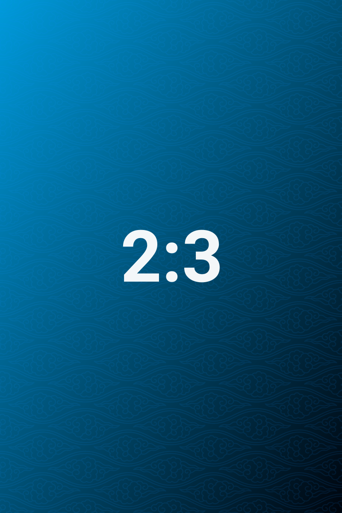

# Row splitting and mixed ratios

> By default a row holds at most five images; how rows are divided is decided by ratios and the minimum row height together, and `ag:rows` can specify how many images each of the first few rows takes.

## Two landscape images: row height about one third of the column width

Two 3:2 landscape images side by side; the row height is about one third of the column width. That is tall enough to make out detail, and short enough that the page doesn't grow long — the row height is never fixed; it is derived from "how many images this row has and how wide each one is".

## Five images: automatically split 3 + 2

"Gallery max per row 5" is a ceiling, not a count you have to fill. The packer gives priority to a readable row height: forcing five into one row leaves each cell only about 120px tall; split 3 + 2, the two rows get 205px and 296px respectively. So the default result is 3 + 2, not one row of five.

If you really do want five in one row, specify it with `ag:rows` (see the next section) — specified rows skip the minimum row height limit.

## Seven images: specified as 5 + 2

Without `ag:rows`, seven images split automatically into several rows according to the minimum row height; with `ag:rows=5,2` it is pinned to "five, then two". Specified rows skip the minimum row height limit — this is a split you wrote by hand, and the plugin no longer decides for you.

The parameter only describes the first few rows and does not have to add up to the number of images in the group: with `ag:rows=5`, the remaining two keep packing automatically; with `ag:rows=5,3` in a group of only six, the second row is cut off at the last image and becomes "five + one"; with `ag:rows=5,2` in a group of eight, the eighth image is appended by automatic layout. The parameter never loses an image; at most it describes fewer rows than actually appear.

## Mixed ratios

When an extreme strip shares a row with a portrait image, the row height is solved from the condition that "the whole row adds up to exactly the column width"; the more extreme the ratio, the further the column width it receives deviates from the average, but every cell always ends up the same height.

## Related

- Row height cap and orphans: [[05-row-height-and-orphans]]
- Gallery handles: [[06-gallery-handles]]

---

Previous · [[03-grouping]] ｜ [[README|Contents]] ｜ Next · [[05-row-height-and-orphans]]
