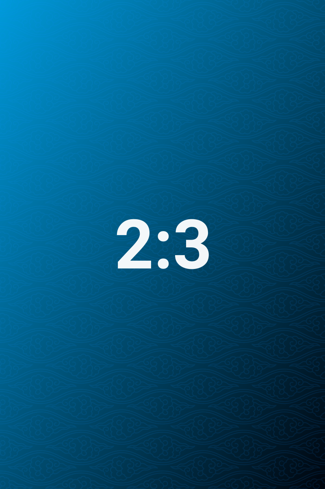

# 行切分与混合比例

> 默认一行最多五张；行的划分由比例与最小行高共同决定，也可以用 `ag:rows` 指定前几行各放几张。

## 两张横图：行高约为栏宽的三分之一

两张 3:2 横图并排，行高约为栏宽的三分之一。这个高度足够看清细节，也不会让页面变得很长 —— 行高从来不是固定的，它由「这一行有几张、各自多宽」反推出来。

## 五张：自动分成 3 + 2

「最大并列 5」是一个上限，不是必须凑满的数量。打包器优先保证行高可读：把五张硬塞进一行，每格只有 120px 左右高；拆成 3 + 2 之后，两行分别有 205px 与 296px。所以默认结果是 3 + 2，而不是一行五张。

如果确实要一行五张，用 `ag:rows` 指定（见下一节）—— 指定的行会跳过最小行高限制。

## 七张：指定为 5 + 2

不写 `ag:rows` 时，七张会按最小行高自动拆成多行；写上 `ag:rows=5,2` 就固定成「前五后二」。指定的行会跳过最小行高限制 —— 这是你亲手写下的切分，插件不再替你做主。

参数只描述开头几行，不要求和等于组内图片数：写 `ag:rows=5` 时，后两张继续自动打包；写 `ag:rows=5,3` 而组里只有六张时，第二行在最后一张处截断，变成「五 + 一」；写 `ag:rows=5,2` 而组里有八张时，第八张按自动布局接在末尾。参数永远不会丢图，最多只描述得比实际少。

## 混合宽高比

极端长条与竖图同排时，行高由「整行加起来正好填满栏宽」这个条件解出；比例越极端，分到的列宽越偏离平均值，但所有格子的高度始终一致。

## 相关

- 行高上限与孤儿：[[05-行高上限与孤儿]]
- 画廊手柄：[[06-画廊手柄]]

---

上一篇 · [[03-分组规则]] ｜ [[README|目录]] ｜ 下一篇 · [[05-行高上限与孤儿]]
