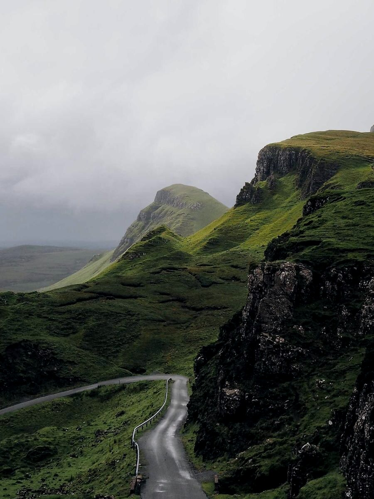

# 画廊手柄

> 鼠标悬停在画廊行上会出现五类手柄；所有拖拽只改写 `ag:crop` 与 `ag:group`，从不保存像素坐标，也从不替你写 `ag:rows`。





## 五类手柄

| 手柄 | 位置 | 作用 | 写回的参数 |
| --- | --- | --- | --- |
| 分隔条 | 两格之间 | 相邻两格此消彼长，行高不变 | 两格的 `ag:crop` |
| 行底横条 | 行下方、图注缝里 | 整行变高或变矮，列宽比例不变 | 每格 `ag:crop` |
| 前后交换 | 格子左右两侧 | 与相邻图交换位置 | 交换两行源码 |
| 并入相邻行 | 行首 / 行尾 | 把这张图移进上一行或下一行 | 重写 `ag:group`，清掉过期的 `ag:rows` |
| 链接按钮 | 格子右下角 | 锁定整行，自动打包不再拆并 | 每格 `ag:group` 写同一 id |

一次拖拽是一次提交、一步撤销；按 Esc 取消并回到拖动前。控件会随格子变窄自动降级：两托盘 → 折叠托盘 → 竖排 → 隐藏，任何情况下都不重叠。

## 锁定整行


同 id 的连续图片锁成一行；相邻两行若写同一个 id 会被吞并成一行，所以必须用不同正整数区分。锁定之后，自动打包不会再把别的图并进来，也不会把这一行拆开。

## 只改参数，不改文件结构

拖完一列之后，源码里只会多出这一格自己的裁剪参数：

```markdown

```

没有像素宽度、没有行内样式。换主题、换字号、换窗口宽度，重新算出来的仍是同一组比例。

拖拽也不会替你写 `ag:rows`：行切分只来自手写，解除行绑定之后，这一组回到自动路由。想固定一行的成员，用右下角的链接按钮写 `ag:group`。

## 相关

- 参数含义：[[10-参数速查]]
- 裁剪几何：[[11-裁剪]]
- 单图的拖宽与对齐：[[09-拖宽与对齐]]

---

上一篇 · [[05-行高上限与孤儿]] ｜ [[README|目录]] ｜ 下一篇 · [[07-宽度路由]]
