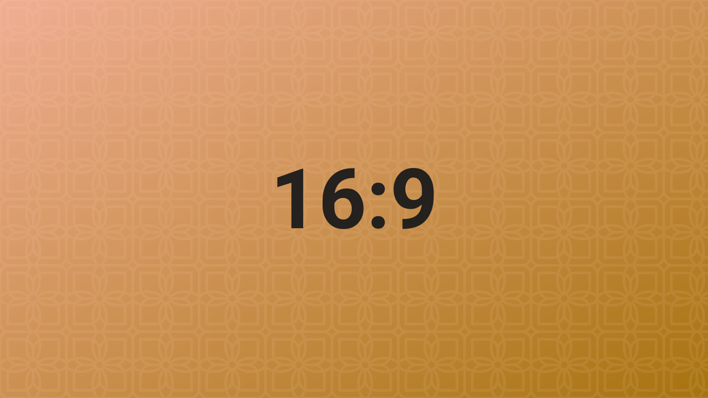
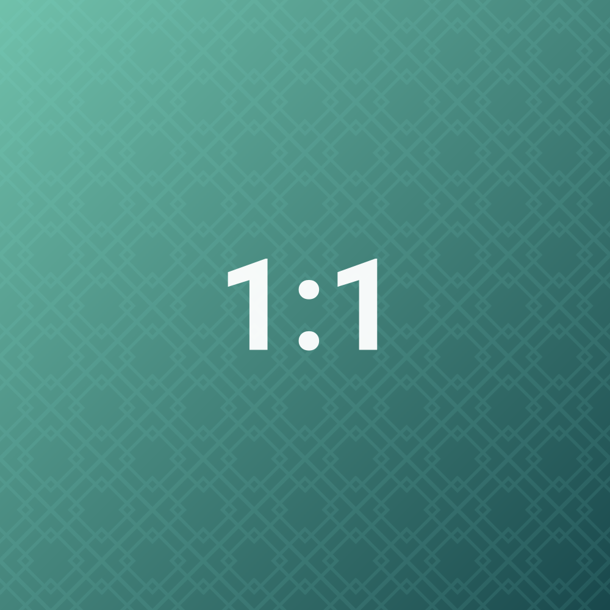
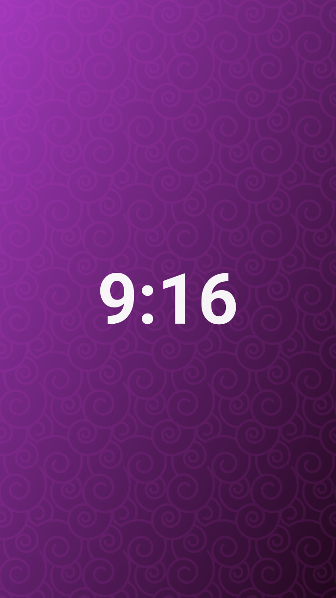

# Width routing

> A single image's width is not fixed: the wider its ratio, the more column width it takes. Above the float threshold it is centred; at or below it, it sits against one edge and lets the text wrap.

## 21:9 and 16:9

A 21:9 image takes **75%** of the column (569px in a 760px column). Because that is above the float threshold, it is centred.

16:9 takes **60%** (458px) and is centred too. It sits right on the threshold — a touch narrower and it would start to float.

## 1:1 and 9:16

A square image takes **39%** (297px). Below the threshold, it floats left, leaving room on the right for the body text.

9:16 drops to **28%** (213px) and floats right instead. Which side an image lands on comes from the template's float direction, not from a random assignment.

## Where the curve comes from

The width percentage is a piecewise power function of the ratio `r` (width ÷ height). The median ratio defaults to `1.5` — so a 3:2 landscape image takes exactly half the column; as the ratio moves toward either extreme, the width approaches the upper and lower bounds by a power law.

Two settings shift the whole curve:

| Setting | Default | Effect |
| --- | --- | --- |
| Width gain | 50 (neutral) | The higher it is, the wider wide images get and the narrower narrow ones get |
| Median ratio | 1.5 | Which ratio is mapped to 50% column width |

To replace the curve entirely, override it with a template rule — see [[14-layout-templates]].

## When the curve is overridden

| Condition | Result |
| --- | --- |
| `ag:width` is set | That percentage is used directly; nothing is computed |
| Computed width > `floatMax` (default 60%) | Becomes a centred block; no float |
| Column width < `mobileBreakpoint` (default 600px) | Always a centred block; no float |

## Related

- Where floats stop and how text wraps: [[08-float-and-wrap]]
- Template rules: [[14-layout-templates]]

---

Previous · [[06-gallery-handles]] ｜ [[README|Contents]] ｜ Next · [[08-float-and-wrap]]
