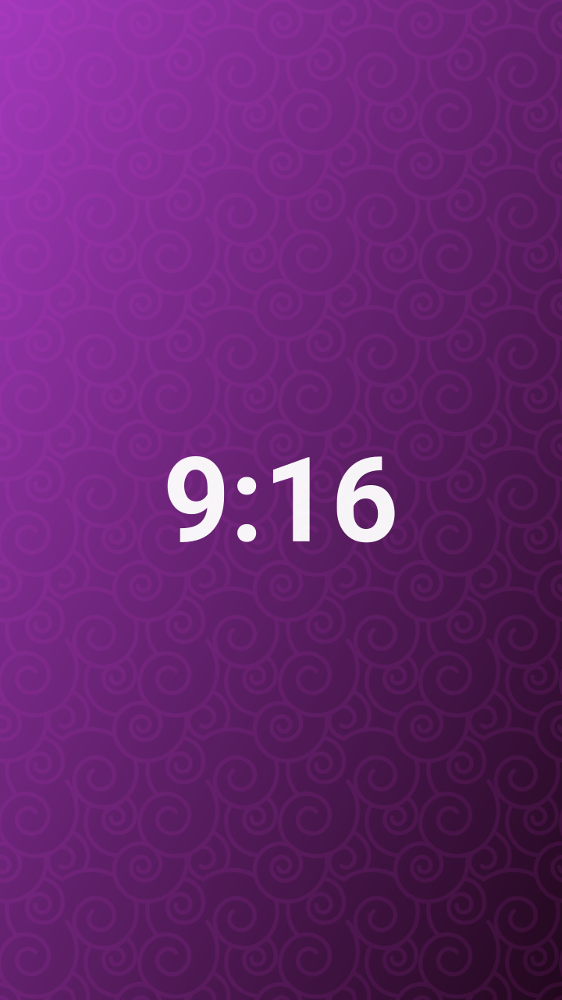

# 宽度路由

> 单图的宽度不是固定的：比例越宽，占的栏宽越多；超过浮动阈值就改为居中，不超过就靠边让文字绕排。

## 21:9 与 16:9

21:9 的宽图占栏宽 **75%**（760px 栏宽下 569px）。因为超过浮动阈值，它改为居中显示。

16:9 占 **60%**（458px），同样居中。它正好压在阈值上 —— 再窄一点就会开始浮动。

## 1:1 与 9:16

方图占 **39%**（297px）。宽度在阈值以下，于是靠左浮动，右侧留出空间给正文。

9:16 只剩 **28%**（213px），换成靠右浮动。左右轮替由模板的浮动方向决定，不是随机分配。

## 曲线怎么来的

宽度百分比是比例 `r`（宽 ÷ 高）的分段幂函数。中位比例默认 `1.5` —— 也就是 3:2 的横图刚好占一半栏宽；比例往两端走，宽度按幂次逼近上下限。

两个设置项整体平移这条曲线：

| 设置项 | 默认 | 作用 |
| --- | --- | --- |
| 栏宽增益 | 50（中性） | 越大，宽图更宽、窄图更窄 |
| 中位比例 | 1.5 | 把哪个比例定为 50% 栏宽 |

想彻底换一条曲线，用模板规则覆盖，见[[14-布局模板]]。

## 什么时候不按曲线走

| 条件 | 结果 |
| --- | --- |
| 写了 `ag:width` | 直接用这个百分比，不再计算 |
| 计算宽度 > `floatMax`（默认 60%） | 改为居中块，不浮动 |
| 栏宽 < `mobileBreakpoint`（默认 600px） | 一律居中块，不浮动 |

## 相关

- 浮动的终止与绕排：[[08-浮动与绕排]]
- 模板规则：[[14-布局模板]]

---

上一篇 · [[06-画廊手柄]] ｜ [[README|目录]] ｜ 下一篇 · [[08-浮动与绕排]]
