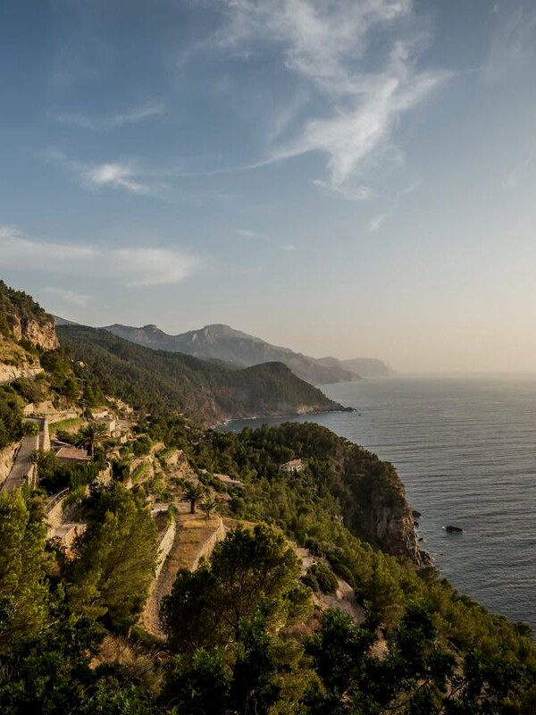

# Parameter reference

> Every parameter is written in the image caption (alt text) and separated by `|`; a field starting with `ag:` is a parameter, and the first field that is not one is the caption.

| Parameter | Values | Effect | Scope |
| --- | --- | --- | --- |
| `ag:layout` | `auto` `gallery` `float` `center` | Override the automatic layout | Single image |
| `ag:side` | `left` `right` `center` | Set the direction; `center` never floats | Single image |
| `ag:width` | `10%`–`100%` | Fixed column-width percentage | Single image |
| `ag:gap` | `0`–`80` (`px` optional) | Gap between a floated image and the body text | Floats only |
| `ag:crop` | `W:H` | Aspect ratio of the frame; only that region is shown | Single image, table |
| `ag:top` | `x1:x2:y` (each 0–100) | Horizontal range and vertical position of the crop frame's top edge | Must be written with `ag:crop` |
| `ag:isolate` | flag / `=false` | Removes this image from the gallery and cuts the grouping before and after it | Any |
| `ag:exclude` | flag / `=false` | Hands the image entirely back to Obsidian's native rendering | Any |
| `ag:rows` | `3,2` | Hand-written row split: how many images each row holds from the first; the rest is routed | Gallery |
| `ag:group` | flag / positive integer / `=false` | Locks a whole row together; adjacent rows need different ids | Gallery |

## Centred with a fixed width

`ag:layout=center` takes the image out of automatic floating; `ag:width=52%` pins its width at about half the column. When both are written, width wins over automatic routing.

## Right float with a larger gap

This text wraps around the image on the right. `ag:gap=24px` only widens the space between the image and the body text — it does not affect the gap between gallery cells; that value lives under "Gallery image gap" in the settings tab. Note: Live Preview does not wrap body text; to see the wrap, use Reading view.

## Isolate and exclude

`ag:isolate` makes this image take a row of its own and cuts the grouping before and after it:

`ag:exclude` is entirely different: the plugin does not take the image over at all, and it keeps Obsidian's native styling — no caption, no width, no crop. Good for "I want to control this image with my own HTML".

| Parameter | Plugin control | Caption | Gallery |
| --- | --- | --- | --- |
| `ag:isolate` | Yes, but cuts the grouping | Kept | Not included |
| `ag:exclude` | No | Not shown | Not included |

What they share is "not squeezed in with other images"; the difference is who does the layout: the former still has its width computed by the plugin, the latter goes back to Obsidian.

## Locking a row split

`ag:rows=2,2` on the group's first image means "the first two in one row, the next two in one row". It only describes the opening rows: with `ag:rows=2` the remaining two are still packed automatically; with `ag:rows=2,3` on a group of only three, the second row is truncated at the last image. The parameter never loses an image, and no gesture writes it automatically.

## Related

- Gallery grouping: [[03-grouping]]
- Crop details: [[11-cropping]]
- Gestures only write `ag:crop` / `ag:group`: [[06-gallery-handles]]

---

Previous · [[09-resize-and-align]] | [[README|Contents]] | Next · [[11-cropping]]
