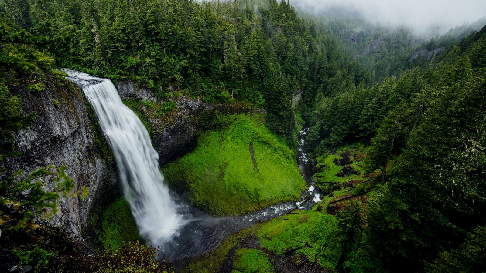
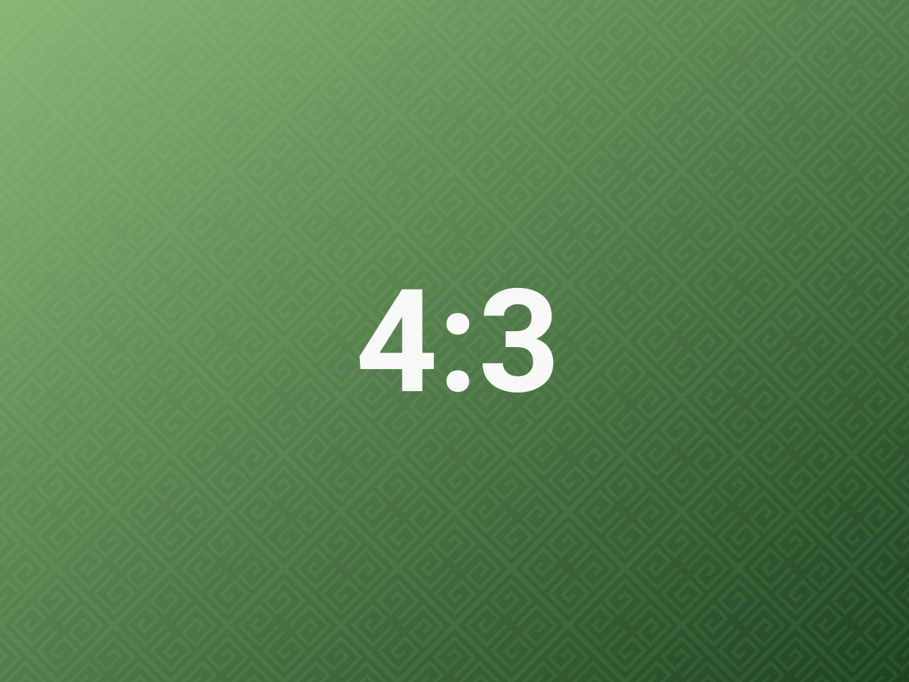

# 裁剪

> `ag:crop=W:H` 决定画幅比例，`ag:top=x1:x2:y` 决定画框落在原图的哪个位置；不想手写坐标就用裁剪对话框。

## 未裁剪

原图 16:9，完整显示。

## 裁成方形

`ag:crop=1:1` 把画幅改成正方形；`ag:top=25:75:2` 取横向 25%–75%、纵向从 2% 开始的那一块。纵向只写一个数，因为高度已经由比例推断出来。

## 取任意局部

第一张取左上角一块，第二张取右侧偏上的方形。参数越界时插件会自动夹紧到画面内；左右端点写反也会自动交换，不会得到一张空白图。

## 裁剪对话框

不想算坐标时，悬停图片点剪刀图标。上面这张就是对话框保存后的结果 —— 它只写入 `ag:crop` 与 `ag:top` 两个参数。

| 操作 | 效果 |
| --- | --- |
| 拖某条边 | 只移动这条边，其余三边不动 |
| 拖角点 | 同时移动相邻两条边 |
| `Shift` + 拖 | 锁定当前比例 |
| `Alt` + 拖 | 以中心为对称点缩放 |
| 滚轮 | 放大编辑视图（1–4×），不改变裁剪结果 |
| 比例下拉 | 自由 / 当前比例 / 1:1 / 4:3 / 3:2 / 16:9 / 9:16 / 3:4 / 2:3 |
| 保存 | 写入 `ag:crop` 与 `ag:top` |
| 清除裁剪 | 移除两个参数，恢复完整画面 |
| 重置取景 | 只把画框拉回全图，不关闭对话框 |

「当前比例」只在没有锁定预设时出现；下次打开会沿用上次选择的比例。画框覆盖全图时保存不会写入任何参数 —— 避免把「没裁」记成「裁了但等于原图」，那样比例会被锁死。

有未保存改动时，点空白处、按 `Esc` 或点取消都会先问一句「放弃修改？」。

对话框本身在**实时预览**里打开，阅读视图没有入口。

## 裁剪会改变宽度路由

裁成方形之后，插件用的是**裁剪后的比例**，不是原图比例：一张 16:9 的宽图裁成 1:1，会自动从接近满栏收窄到一半左右，并且重新判断是否浮动。这意味着裁剪不只改画面内容，也会改变它在页面上的位置 —— 这是预期行为。

如果裁剪框会让图片底边超出原图，插件选择**放宽画框**而不是裁掉内容：宁可多一点画面，也不切掉读者想要的边。

## 相关

- 参数语法：[[10-参数速查]]
- 表格里只有 `ag:crop` 生效：[[12-嵌套作用域]]
- 宽度曲线：[[07-宽度路由]]

---

上一篇 · [[10-参数速查]] ｜ [[README|目录]] ｜ 下一篇 · [[12-嵌套作用域]]
