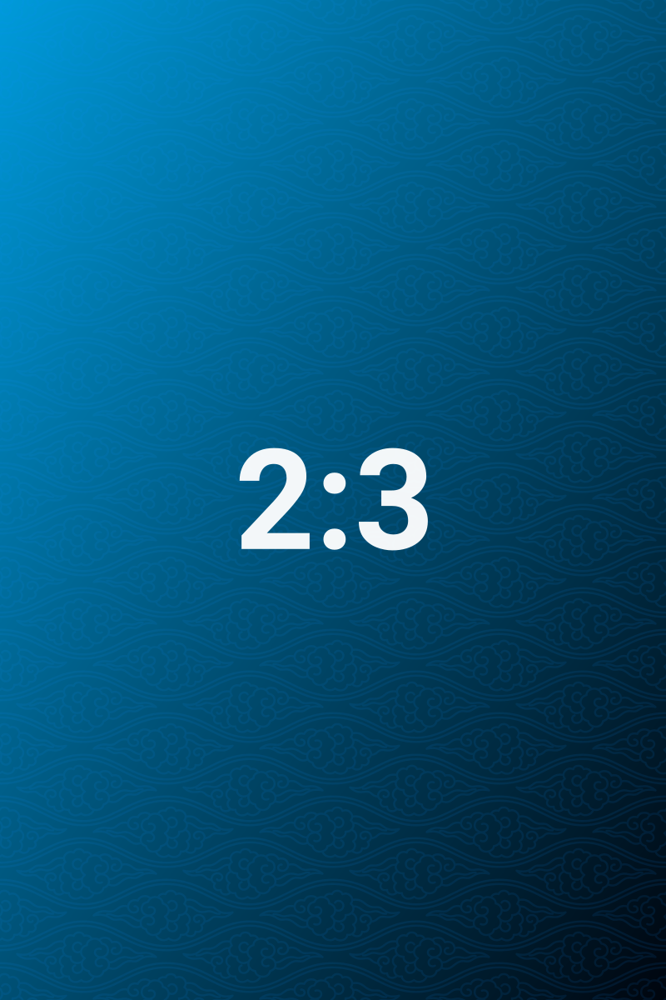

# Frontmatter Routing

> Write one line `album = trip → wide` in the settings page and this note picks up the `wide` template; matching is an exact string comparison, top to bottom.

This note has `album: trip` in its frontmatter, so it hits the single route preset in this vault and uses the `wide` template. The three images below carry no `ag:width` at all; their widths come entirely from the template's three rules.

## Single image comparison

The same 1:1 calibration image takes up about half the column width under the `auto` template; here, because it hits the `wide` template, its width becomes 68% (about 517px in a 760px column) and it is still centred.

Compare it with the image of the same ratio in [[07-width-routing]] to see the difference between the two templates at a glance.

## Portrait comparison

The same 2:3 portrait. The third rule of the `wide` template narrows portraits and pins them to a left float — unlike `auto`, which "scales to thirty percent and alternates sides", the position here is hard-coded by the rule and does not change with image order.

That is what makes templates most useful: the same set of assets, a different template, and the whole rhythm changes, without touching the parameters of a single image.

## Matching rules

| Behaviour | Explanation |
| --- | --- |
| Comparison | Both key and value are `trim()`ed and must be **exactly equal**; `Trip` is not `trip` |
| Order | Top to bottom, stopping at the first hit |
| Default | `auto` is used when no route matches |
| Priority | An image's own `ag:width` / `ag:layout` / `ag:side` beat the template rules |

Array values are joined into a comma-separated string before comparison, so `tags: [a, b]` actually compares `a,b`, which makes it a poor route key.

## When to use routing

Within one vault, when tutorial notes want small images and a portfolio wants large ones, routing is the least-effort way to layer them: each note carries a single frontmatter line, and you do not repeat `ag:width` across dozens of images. Conversely, if only one or two images need a special width, writing the parameter directly is more straightforward.

## Related

- The template rules themselves: [[14-layout-templates]]
- Parameter priority: [[10-parameter-reference]]

---

Previous · [[15-import-and-export]] ｜ [[README|Contents]] ｜ Next · [[17-pdf-export]]
