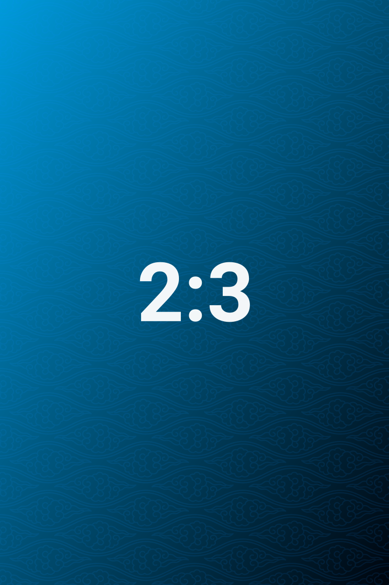

# Frontmatter 路由

> 在设置页写一条 `album = trip → wide`，这篇笔记就会套用 wide 模板；匹配是精确字符串比较，顺序从上往下。

这篇笔记的 frontmatter 里有 `album: trip`，因此它命中了本库预置的唯一一条路由，使用 `wide` 模板。下面三张图没有写任何 `ag:width`，宽度完全由模板的三条规则给出。

## 单图对照

同一张 1:1 的标定图，在 `auto` 模板下约占栏宽的一半；在这里因为命中 `wide` 模板，宽度变为 68%（760px 栏宽下约 517px），并且仍然居中。

对照 [[07-宽度路由]] 里同样比例的图，可以直接看出两个模板的差别。

## 竖图对照

同一张 2:3 竖图。`wide` 模板的第三条规则把竖图压窄并固定靠左浮动 —— 与 `auto` 下「按比例缩到三成、左右轮替」不同，这里的位置由规则写死，不随图片顺序变化。

这也是模板最有用的地方：同一批素材，换一个模板就换了整套节奏，不需要动任何一张图的参数。

## 匹配规则

| 行为 | 说明 |
| --- | --- |
| 比较方式 | 键与值都做 `trim()` 后**精确相等**；`Trip` 不等于 `trip` |
| 顺序 | 从上往下，第一条命中即停止 |
| 缺省 | 没有命中任何路由时使用 `auto` |
| 优先级 | 图片自己的 `ag:width` / `ag:layout` / `ag:side` 高于模板规则 |

数组值会被拼成逗号分隔的字符串再比较，因此 `tags: [a, b]` 实际参与比较的是 `a,b`，不适合做路由键。

## 什么时候该用路由

同一库里，教程类笔记想要小图、作品集想要大图时，路由是最省事的分层方式：每篇笔记只写一行 frontmatter，不需要在几十张图上重复 `ag:width`。反过来，如果只有一两张图需要特殊宽度，直接写参数更直接。

## 相关

- 模板规则本身：[[14-布局模板]]
- 参数优先级：[[10-参数速查]]

---

上一篇 · [[15-导入导出]] ｜ [[README|目录]] ｜ 下一篇 · [[17-PDF导出]]
