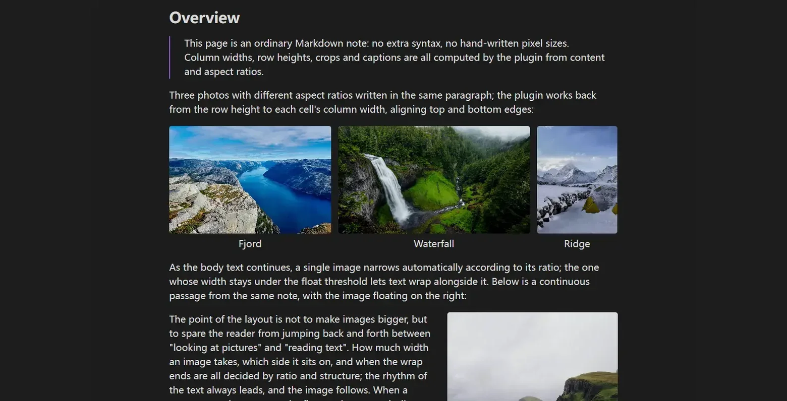

<div align="center">

<h1>AutoGallery</h1>

<p><a href="README.md">中文</a> · <a href="https://www.autogallery.run.place/en/">Documentation</a> · <a href="CONTRIBUTING-EN.md">Contributing</a></p>

<p>
  <a href="LICENSE"></a>
  <a href="https://github.com/JH0531/obsidian-autogallery/releases"></a>
  <a href="https://github.com/JH0531/obsidian-autogallery/stargazers"></a>
  <a href="https://github.com/JH0531/obsidian-autogallery/graphs/contributors"></a>
  <a href="https://www.jsdelivr.com/package/gh/JH0531/obsidian-autogallery"></a>
</p>



<p align="center">
  <a href="https://www.autogallery.run.place/en/"></a>
  &nbsp;&nbsp;&nbsp;&nbsp;
  <a href="https://github.com/JH0531/obsidian-autogallery/archive/refs/heads/demo-en-vault.zip"></a>
</p>

</div>

## Overview

AutoGallery handles image layout in Obsidian notes: consecutive images become rows, single images take their width from their aspect ratio, text can wrap around them, crops are stored as ratios, and PDF export follows the reading view.

It never rewrites Markdown image links or stores pixel dimensions. Layout comes from parameters in the image caption and from exportable layout templates. Disable the plugin and the note renders natively again.

- Built for illustrated notes, portfolios, tutorials and documents meant to be printed.
- Not a pixel-level canvas or an image editor.

## Install

Requires Obsidian 1.5 or newer; desktop and mobile share the same build.

1. Community plugins (after listing): Settings → Community plugins → turn off Safe mode → Browse → search **AutoGallery** → Install and enable.
2. Manual: download `main.js` and `manifest.json` from [Releases](https://github.com/JH0531/obsidian-autogallery/releases), place them in the plugin folder, then restart Obsidian.

```text
<vault>/.obsidian/plugins/obsidian-autogallery/
  main.js
  manifest.json
```

These two files are all that is needed; there is no `styles.css`. Once enabled, an AutoGallery section appears in Settings, and two or three consecutive image lines should become one gallery row.

[Community install](https://www.autogallery.run.place/en/guide/install#from-the-community-plugins) · [Manual install](https://www.autogallery.run.place/en/guide/install#manually)

## Quick start

Three image lines with no blank lines between them become one row of equal height. A blank line ends the gallery.

```markdown
![[photo-01.jpg]]
![[photo-02.jpg]]
![[photo-03.jpg]]
```

Two images side by side get a taller row, so details stay readable:

```markdown
![[photo-04.jpg]]
![[photo-05.jpg]]
```

Three operations cover most edits:

- Give one image its own row: separate it with body text or a heading, or write `ag:isolate`.
- Set images per row: write `ag:rows=2,2` on the first image of the group.
- Change a single image's width: drag its bottom-right grip in Live Preview; `ag:width` is written on release.

Full tutorial: [Quick start](https://www.autogallery.run.place/en/guide/quick-start) · [Three common operations](https://www.autogallery.run.place/en/guide/quick-start#three-common-operations)

## Five core concepts

1. **Grouping reads the source, not the screen**: [Grouping rules](https://www.autogallery.run.place/en/gallery/grouping#rules)
2. **Two or more adjacent images are always a gallery**: [Row splitting](https://www.autogallery.run.place/en/gallery/rows#five-images-automatically-3-2)
3. **A single image gets its width from its ratio**: [Width routing](https://www.autogallery.run.place/en/single/width#the-four-ratios)
4. **The closer the declaration, the higher the priority**: image parameters > template > global settings; [Annotation syntax](https://www.autogallery.run.place/en/annotations/syntax#syntax-rules)
5. **The container decides what is possible**: lists, tables and callouts behave differently; [Nested scopes](https://www.autogallery.run.place/en/annotations/scopes#capability-matrix)

Full explanation: [Five core concepts](https://www.autogallery.run.place/en/guide/concepts)

## Capability map

Grouped by workflow; each group maps to one section of the documentation.

**Galleries** — consecutive images form rows; `ag:rows` splits them and `ag:group` locks a row; row-height ceilings and orphan images; five kinds of handle.
[Grouping](https://www.autogallery.run.place/en/gallery/grouping#rules) · [Row splitting](https://www.autogallery.run.place/en/gallery/rows#five-images-automatically-3-2) · [Height and orphans](https://www.autogallery.run.place/en/gallery/height#row-height-ceiling) · [Gallery handles](https://www.autogallery.run.place/en/gallery/handles#five-kinds-of-handle)

**Single images** — automatic width from ratio; left/right floats and text wrapping; drag to resize, align with arrows, reset in one click.
[Width routing](https://www.autogallery.run.place/en/single/width#the-four-ratios) · [Float and wrap](https://www.autogallery.run.place/en/single/float#text-wrapping) · [Resize, align, reset](https://www.autogallery.run.place/en/single/resize#the-corner-grip)

**Annotations and crops** — ten `ag:` parameters; crop any region by ratio; scope rules for lists, tables and callouts; caption dialog and reset.
[Annotation syntax](https://www.autogallery.run.place/en/annotations/syntax#the-ten-parameters) · [Cropping](https://www.autogallery.run.place/en/annotations/crop#the-crop-dialog) · [Nested scopes](https://www.autogallery.run.place/en/annotations/scopes#capability-matrix) · [Dialog and reset](https://www.autogallery.run.place/en/annotations/dialog#the-caption-dialog)

**Templates and routing** — define a whole width rhythm with range rules; import/export templates; switch by frontmatter.
[Layout templates](https://www.autogallery.run.place/en/templates/profiles#rule-model) · [Import and export](https://www.autogallery.run.place/en/templates/import#overwrite-semantics) · [Frontmatter routing](https://www.autogallery.run.place/en/templates/routing#anatomy-of-a-route)

**PDF export** — reflow to paper size; layout and paginated previews; margins, page numbers and pagination.
[Export dialog](https://www.autogallery.run.place/en/export/dialog#two-previews) · [Pagination](https://www.autogallery.run.place/en/export/pagination) · [Troubleshooting](https://www.autogallery.run.place/en/export/troubleshooting#symptom-table)

**Reference** — settings defaults; commands and entry points; compatibility; common misreadings.
[Settings](https://www.autogallery.run.place/en/reference/settings#gallery) · [Commands](https://www.autogallery.run.place/en/reference/commands#the-four-commands) · [Compatibility](https://www.autogallery.run.place/en/reference/compatibility#versions-and-platforms) · [Pitfalls](https://www.autogallery.run.place/en/reference/pitfalls)

## Annotations and gestures

Parameters live in the image caption, separated by `|`. Omit them and automatic routing applies. Both standard Markdown and `![[...]]` embeds work.

| Parameter | Common values | Effect |
| --- | --- | --- |
| `ag:layout` | `auto` `gallery` `float` `center` | Override automatic layout |
| `ag:side` | `left` `right` `center` | Alignment and float side |
| `ag:width` | `10%`–`100%` | Width of an image or float unit |
| `ag:crop` + `ag:top` | `16:9` + `0:50:0` | Crop ratio and top-edge position |
| `ag:rows` / `ag:group` | `3,2` / `7` | Split rows / lock a row |
| `ag:isolate` / `ag:exclude` | flag | Cut grouping / hand back to Obsidian |

```markdown
![[cover.jpg|Cover|ag:side=center|ag:width=61%]]
![[chart.png|Chart|ag:crop=16:9|ag:top=0:50:0]]

```

All ten parameters: [Annotation syntax](https://www.autogallery.run.place/en/annotations/syntax#the-ten-parameters).

**Gestures** (Live Preview)

- Drag the bottom-right grip to resize; double-click to reset → [Corner grip](https://www.autogallery.run.place/en/single/resize#the-corner-grip)
- Drag a divider to change column widths, or the bar under a row to change its height → [Five handles](https://www.autogallery.run.place/en/gallery/handles#five-kinds-of-handle)
- Use the side buttons to swap or merge, and the link button to lock a row → [Locking a row](https://www.autogallery.run.place/en/gallery/handles#locking-a-row)
- Use the arrows in the free space beside an image to change alignment → [Alignment arrows](https://www.autogallery.run.place/en/single/resize#alignment-arrows)

## PDF export

Run **Export PDF (AutoGallery)** from the command palette, or export from the file context menu. The plugin renders in the main window, measures against the paper size, and paginates.

- **Two previews**: layout preview shows continuous flow; paginated preview shows real page boundaries, margins, page numbers and heading breaks.
- **Controls**: paper size, orientation, margin presets and mirrored margins, scale, header/footer page numbers.
- **Pagination**: gallery rows never split, a single image can shrink to the page foot, headings can start a page, and trailing orphan lines are pulled back.

[Export dialog](https://www.autogallery.run.place/en/export/dialog#two-previews) · [Pagination](https://www.autogallery.run.place/en/export/pagination) · [Troubleshooting](https://www.autogallery.run.place/en/export/troubleshooting#symptom-table)

## Development

```bash
npm install
npm run build
```

The build output is `main.js` in the repository root. Copy it and `manifest.json` into a test vault at `.obsidian/plugins/obsidian-autogallery/` and reload the plugin. There is no test script; static checks are `npm run build`, `git diff --check` and `npm run check:docs`.

The rendering pipeline and architectural constraints are in [CONTRIBUTING-EN.md](CONTRIBUTING-EN.md#architecture); design notes live in [`specifications/`](specifications/). Read the [contributing guide](CONTRIBUTING-EN.md) before opening a pull request.

## Credits

- [Adjustable Media](https://github.com/Yi-luo-hua/obsidian-adjustable-media) — layout blocks and media typography.
- [Better Export PDF](https://github.com/l1xnan/obsidian-better-export-pdf) — PDF preview, headers/footers and page-number templates.

Full changes: [Changelog](https://www.autogallery.run.place/en/changelog); the complete map: [Documentation map](https://www.autogallery.run.place/en/guide/map).

## Support

If AutoGallery saves you time, you can support its development:

- [Ko-fi](https://ko-fi.com/jh0531)
- [Personal funding website (WeChat, Alipay, PayPal)](https://www.opensponsor.dpdns.org/)

## License

This project is licensed under the GNU General Public License v3.0 or later (GPL-3.0-or-later). See [LICENSE](LICENSE) for the full text.
