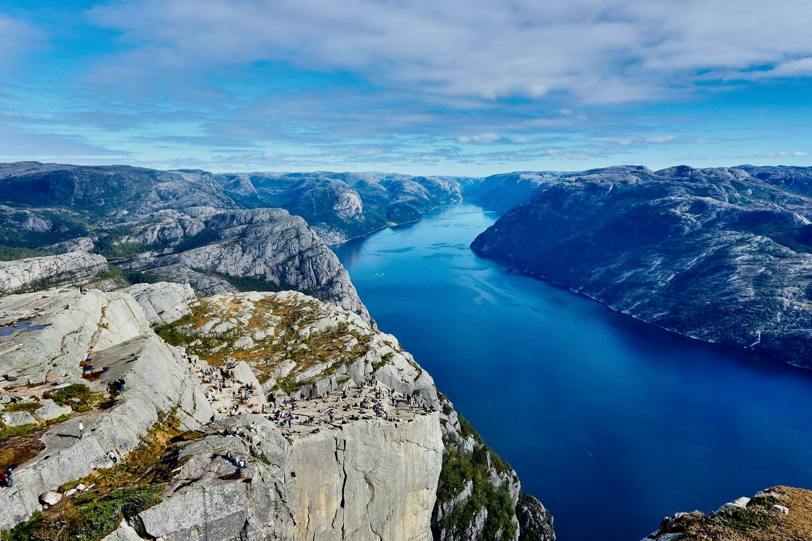

# AutoGallery demo vault

> This is a sample vault you can open directly: every note is itself the effect being demonstrated, not a screenshot.
> After installing [AutoGallery](https://github.com/JH0531/obsidian-autogallery), read in order—about 25 minutes covers every feature.

In the source file the three images above are just three plain image references with no extra syntax. Their ratios are 3:2, 16:9, and 3:4; the plugin derives column widths from row height so the three cells align exactly at top and bottom.

## Start with one page

[[00-overview]] is a carefully laid-out ordinary note: galleries, float wrapping, cropping, captions, and multi-image rhythm all appear on the same page. Scroll from top to bottom to see the plugin's full effect, without comparing chapter by chapter.

## Before you read

- Obsidian 1.5 or later, AutoGallery enabled, with the vault's bundled settings kept (`galleryMaxPerRow=5`, `floatMax=60`, orphan limit 400).
- Most effects are most complete in **Reading view**; chapters involving dragging, handles, and the crop dialog need **Live Preview**.
- This vault fixes the font size (16px) and line width (760px), so the line breaks you see match the assets; changing the appearance removes the reference point for typesetting comparisons.

## Contents

Seven groups, matching the doc site's sidebar one to one.

| Group | Note | What you'll see |
| --- | --- | --- |
| **Getting started** | [[01-quick-start]] | How three image lines become one gallery row |
| | [[02-core-concepts]] | Grouping, gallery, width, priority, containers |
| **Galleries** | [[03-grouping]] | How blank lines, body text, and headings break a group |
| | [[04-row-splitting]] | How 2/5/7 images split into rows, and how mixed ratios stay equal-height |
| | [[05-row-height-and-orphans]] | Why some images jump out of the gallery |
| | [[06-gallery-handles]] | Drag column width, drag row height, swap, merge, lock |
| **Single images** | [[07-width-routing]] | How width follows the ratio |
| | [[08-float-and-wrap]] | Where text wrapping ends |
| | [[09-resize-and-align]] | Drag the corner to change width, use the arrows to change alignment |
| **Parameters and cropping** | [[10-parameter-reference]] | Ten `ag:` parameters, one example line each |
| | [[11-cropping]] | Hand-written parameters vs. graphical cropping |
| | [[12-nested-scopes]] | What applies inside lists, tables, and callouts |
| | [[13-dialog-and-reset]] | Fill a form to write parameters, clear, restore the whole document |
| **Templates and routing** | [[14-layout-templates]] | Change the width curve with rule expressions |
| | [[15-import-and-export]] | Rule file format and validation |
| | [[16-routing]] | Switch templates by note properties |
| **PDF** | [[17-pdf-export]] | Paper, margins, scale, page numbers |
| | [[18-pdf-pagination]] | How gallery rows, single images, headings, and orphans paginate |
| **Reference** | [[19-settings]] | Seven sections, contents search, instant effect |
| | [[20-commands-and-undo]] | Four commands and one-step undo |
| | [[21-pitfalls]] | Sixteen "this is not a bug" |

## Assets and provenance

- The 11 landscape photos in `assets/photo/` show real ratios; the 10 calibration images in `assets/ratio/` carry ratio and pixel labels, used to verify equal-height alignment and column-width routing.
- All notes, configuration, and the index were created for this vault; no notes are reused from other vaults.
- This vault is also the asset source for the doc site and the README: stills, GIFs, and screen recordings are registered in `media/manifest.json` numbered `AG-<medium><page-index>-<index>` (media is not part of this vault's release package, see `.tools/figures.md`).

## Version anchor

| Item | Value |
| --- | --- |
| Plugin version | 0.1.0 |
| Corresponding build | `7827089` |
| Baseline (`data.json`) | Full 24 keys, `profiles=auto/wide/tight`, `routes=album:trip→wide` |
| Last calibrated | 2026-11-09 |
