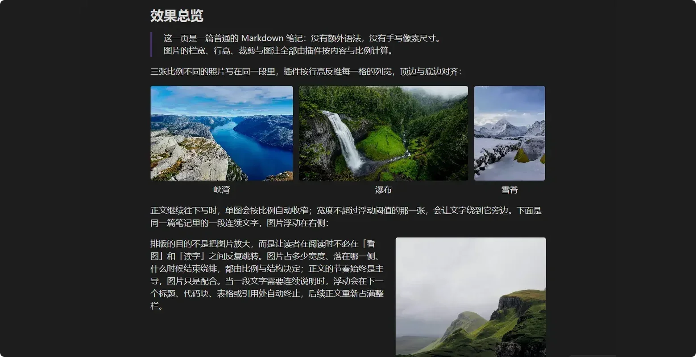

<div align="center">

<h1>AutoGallery</h1>

<p><a href="README-EN.md">English</a> · <a href="https://www.autogallery.run.place/zh/">在线文档</a> · <a href="CONTRIBUTING.md">贡献指南</a></p>

<p>
  <a href="LICENSE"></a>
  <a href="https://github.com/JH0531/obsidian-autogallery/releases"></a>
  <a href="https://github.com/JH0531/obsidian-autogallery/stargazers"></a>
  <a href="https://github.com/JH0531/obsidian-autogallery/graphs/contributors"></a>
  <a href="https://www.jsdelivr.com/package/gh/JH0531/obsidian-autogallery"></a>
</p>



<p align="center">
  <a href="https://www.autogallery.run.place/zh/"></a>
  &nbsp;&nbsp;&nbsp;&nbsp;
  <a href="https://github.com/JH0531/obsidian-autogallery/archive/refs/heads/demo-vault.zip"></a>
</p>

</div>

## 简介

AutoGallery 处理 Obsidian 笔记里的图片排版：连续图片自动成行，单图按比例取宽，文字可以绕排，裁剪只记录比例，PDF 导出与阅读视图保持一致。

它不改写 Markdown 图片链接，也不写入像素尺寸；效果来自图片说明里的参数与可导出的布局模板。停用插件后，笔记仍按原生方式显示。

- 适合图文笔记、作品集、教程和需要打印的文档。
- 不提供像素级画布或图片编辑功能。

## 安装

要求 Obsidian 1.5 或更高版本；桌面端与移动端共用同一份插件。

1. 社区市场（上架后）：设置 → 第三方插件 → 关闭安全模式 → 浏览 → 搜索 **AutoGallery** → 安装并启用。
2. 手动安装：从 [Releases](https://github.com/JH0531/obsidian-autogallery/releases) 下载 `main.js` 与 `manifest.json`，放入库的插件目录，重启 Obsidian。

```text
<库>/.obsidian/plugins/obsidian-autogallery/
  main.js
  manifest.json
```

安装只需要这两个文件，没有额外的 `styles.css`。装好后设置页会出现 AutoGallery 一栏；连续写两三行图片应变成一行画廊。

[社区市场安装](https://www.autogallery.run.place/zh/guide/install#从社区市场安装) · [手动安装](https://www.autogallery.run.place/zh/guide/install#手动安装)

## 五分钟上手

三行图片之间不留空行，就会排成一行等高画廊；空行会结束画廊。

```markdown
![[photo-01.jpg]]
![[photo-02.jpg]]
![[photo-03.jpg]]
```

两图并排时行高更高，细节更清楚：

```markdown
![[photo-04.jpg]]
![[photo-05.jpg]]
```

三个最常用的操作：

- 让某张图独占一行：用正文或标题隔开，或写 `ag:isolate`。
- 指定每行张数：在组内第一张写 `ag:rows=2,2`。
- 改单图宽度：在实时预览里拖右下角，松开后写入 `ag:width`。

完整教程：[五分钟上手](https://www.autogallery.run.place/zh/guide/quick-start) · [三个常用操作](https://www.autogallery.run.place/zh/guide/quick-start#三个常用操作)

## 五个核心概念

1. **分组看源码，不看屏幕**：[分组规则](https://www.autogallery.run.place/zh/gallery/grouping#规则表)
2. **两张以上连续图片一定是画廊**：[行切分](https://www.autogallery.run.place/zh/gallery/rows#五张-自动分成-3-2)
3. **单图宽度由比例算出**：[宽度路由](https://www.autogallery.run.place/zh/single/width#四档比例)
4. **声明越近，优先级越高**：图片参数 > 模板 > 全局设置；[参数语法](https://www.autogallery.run.place/zh/annotations/syntax#语法规则)
5. **容器决定能力**：列表、表格、callout 的规则不同；[嵌套作用域](https://www.autogallery.run.place/zh/annotations/scopes#能力矩阵)

完整解释：[五个核心概念](https://www.autogallery.run.place/zh/guide/concepts)

## 能力地图

按工作流分组；每组对应文档站的一个栏目。

**画廊** — 连续图片自动成行；`ag:rows` 切分、`ag:group` 锁定；行高上限与孤儿图片；五类手柄。
[分组](https://www.autogallery.run.place/zh/gallery/grouping#规则表) · [行切分](https://www.autogallery.run.place/zh/gallery/rows#五张-自动分成-3-2) · [行高与孤儿](https://www.autogallery.run.place/zh/gallery/height#行高上限) · [画廊手柄](https://www.autogallery.run.place/zh/gallery/handles#五类手柄)

**单图** — 按比例自动取宽；左右浮动与文字绕排；拖角标改宽、箭头对齐、一键复位。
[宽度路由](https://www.autogallery.run.place/zh/single/width#四档比例) · [浮动与绕排](https://www.autogallery.run.place/zh/single/float#文字绕排) · [拖宽、对齐与复位](https://www.autogallery.run.place/zh/single/resize#拖角标)

**参数与裁剪** — 十个 `ag:` 参数；按比例裁剪任意局部；列表/表格/callout 的作用域；说明对话框与重置。
[参数语法](https://www.autogallery.run.place/zh/annotations/syntax#十个参数) · [裁剪与取景](https://www.autogallery.run.place/zh/annotations/crop#裁剪对话框) · [嵌套作用域](https://www.autogallery.run.place/zh/annotations/scopes#能力矩阵) · [说明与重置](https://www.autogallery.run.place/zh/annotations/dialog#图片说明对话框)

**模板与路由** — 用区间规则定义整套宽度节奏；导入/导出模板；按 frontmatter 切换。
[布局模板](https://www.autogallery.run.place/zh/templates/profiles#规则模型) · [导入与导出](https://www.autogallery.run.place/zh/templates/import#覆盖式更新) · [Frontmatter 路由](https://www.autogallery.run.place/zh/templates/routing#一条路由的结构)

**PDF 导出** — 按纸张重新排版；整页/分页预览；页边距、页码与分页优化。
[导出对话框](https://www.autogallery.run.place/zh/export/dialog#两种预览) · [分页优化](https://www.autogallery.run.place/zh/export/pagination) · [失败与排查](https://www.autogallery.run.place/zh/export/troubleshooting#症状对照表)

**参考** — 设置项默认值；命令与入口；兼容性；常见误解。
[设置项总表](https://www.autogallery.run.place/zh/reference/settings#画廊) · [命令](https://www.autogallery.run.place/zh/reference/commands#四条命令) · [兼容性](https://www.autogallery.run.place/zh/reference/compatibility#版本与平台) · [容易误解的行为](https://www.autogallery.run.place/zh/reference/pitfalls)

## 常用参数与手势

参数写在图片说明里，用 `|` 分隔；不写就走自动路由。标准 Markdown 与 `![[...]]` 都支持。

| 参数 | 常用值 | 作用 |
| --- | --- | --- |
| `ag:layout` | `auto` `gallery` `float` `center` | 覆盖自动布局 |
| `ag:side` | `left` `right` `center` | 指定对齐与浮动方向 |
| `ag:width` | `10%`–`100%` | 指定图片或浮动单元宽度 |
| `ag:crop` + `ag:top` | `16:9` + `0:50:0` | 裁剪比例与顶边位置 |
| `ag:rows` / `ag:group` | `3,2` / `7` | 手写行切分 / 锁定整行 |
| `ag:isolate` / `ag:exclude` | 标记 | 切断分组 / 交还原生渲染 |

```markdown
![[cover.jpg|封面|ag:side=center|ag:width=61%]]
![[chart.png|图表|ag:crop=16:9|ag:top=0:50:0]]

```

十个参数的完整说明：[参数语法](https://www.autogallery.run.place/zh/annotations/syntax#十个参数)。

**手势**（实时预览）

- 拖右下角改宽度，双击复位 → [拖角标](https://www.autogallery.run.place/zh/single/resize#拖角标)
- 拖分隔条改列宽，拖行底横条改行高 → [五类手柄](https://www.autogallery.run.place/zh/gallery/handles#五类手柄)
- 两侧按钮交换/并入，链接按钮锁定整行 → [锁定整行](https://www.autogallery.run.place/zh/gallery/handles#锁定整行)
- 图片空余侧的箭头切换对齐 → [对齐箭头](https://www.autogallery.run.place/zh/single/resize#对齐箭头)

## PDF 导出

命令面板执行 **Export PDF (AutoGallery)**，或在文件右键菜单导出。插件在主窗口按纸张尺寸渲染、测量并分页。

- **两种预览**：版式预览看连续排版，分页预览看真实页边界；页边距、页码与标题分页可即时核对。
- **可调项**：纸张、方向、边距预设与奇偶页镜像、缩放、页眉页脚页码。
- **分页**：画廊行不拆页，单图可贴底压缩，标题可另起一页，末页孤行可回收。

[导出对话框](https://www.autogallery.run.place/zh/export/dialog#两种预览) · [分页优化](https://www.autogallery.run.place/zh/export/pagination) · [失败与排查](https://www.autogallery.run.place/zh/export/troubleshooting#症状对照表)

## 开发与贡献

```bash
npm install
npm run build
```

构建产物是根目录的 `main.js`；把它和 `manifest.json` 复制到测试库的 `.obsidian/plugins/obsidian-autogallery/`，重载插件即可。仓库没有测试脚本，静态检查用 `npm run build`、`git diff --check` 与 `npm run check:docs`。

渲染管线与架构约束见 [CONTRIBUTING.md](CONTRIBUTING.md#architecture)；设计推导见 [`specifications/`](specifications/)。提交前请读[贡献指南](CONTRIBUTING.md)。

## 参考与致谢

- [Adjustable Media](https://github.com/Yi-luo-hua/obsidian-adjustable-media) — 布局块与媒体排版思路。
- [Better Export PDF](https://github.com/l1xnan/obsidian-better-export-pdf) — PDF 预览、页眉页脚与页码模板。

完整变更见 [Changelog](https://www.autogallery.run.place/zh/changelog)；文档全貌见 [文档地图](https://www.autogallery.run.place/zh/guide/map)。

## 支持

如果 AutoGallery 节省了你的时间，可以通过以下方式支持开发：

- [Ko-fi](https://ko-fi.com/jh0531)
- [个人赞助页（微信、支付宝、PayPal）](https://www.opensponsor.dpdns.org/)

<details>
<summary>微信赞赏码</summary>

</details>

## 许可证

本项目根据 GNU 通用公共许可证第 3 版或更高版本（GPL-3.0-or-later）授权，完整条款见 [LICENSE](LICENSE)。
